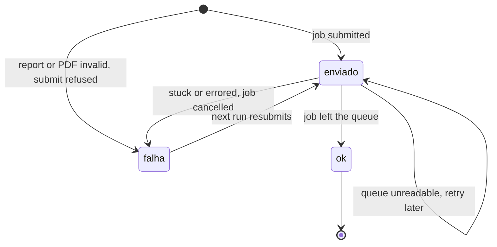

# printguard

[](https://github.com/sergiomeyer23/print-guard/actions/workflows/ci.yml)

Scheduled reports that print, confirm the job left the queue, and alert you when they don't.

## The problem

A scheduled task that prints a report can report success while nothing comes out of the printer. The script exits 0 because it handed the file to the spooler. The spooler then holds the job: the printer is offline, a bad document is blocking the queue, or the machine rebooted halfway through. Nobody finds out until someone asks where the morning report is.

printguard treats "sent" and "printed" as two different states. It builds the PDF, submits it, and keeps reading the queue until the job is gone. If that doesn't happen it cancels the job, writes an alert file and tries again on the next scheduled run. Each day has a small JSON state file, so a retry or a reboot never prints the same report twice.

## Demo

```bash
pip install -e ".[dev]"
printguard seed
printguard run
```

`seed` builds a SQLite file of made-up shipments. `run` queries it, renders `out/report_<date>.pdf` with the query time in the header, prints through the simulated printer and marks the day `ok` only after the job is confirmed. Run it again and nothing prints.

To watch a failure, jam the simulated queue:

```bash
printguard seed --force
printguard run --sim-fail stuck --confirm-timeout 4
```

The job is cancelled, the state becomes `falha`, and `out/ALERTA_<date>.txt` gets a line like `job sim-1 not confirmed (last status: queued)`. Run without `--sim-fail` and the next attempt prints once and closes the day.

## Commands

| Command | What it does |
|---|---|
| `printguard seed` | Creates the sample database. Refuses to overwrite without `--force`. |
| `printguard run` | Queries, renders, prints and confirms. Skips the day if it is already `ok`. |
| `printguard print-only` | Reprints today's existing PDF. Does not touch the data source. |
| `printguard check` | Exit code 0 for `ok`, 1 for `falha`, 2 for anything not yet confirmed. With `--deadline HH:MM` it also writes an alert if the day isn't `ok` by then. |

Printer options: `--printer simulated` (default) or `--printer spooler --printer-name "Name"`. Add `--event-log` on Windows to also write alerts to the Application event log.

## How a day moves



More detail in [docs/architecture.md](docs/architecture.md).

## Failure modes

| Failure | What printguard does |
|---|---|
| Job stuck in the queue | Waits up to the confirm timeout, cancels the job, state `falha`, alert |
| Queue unreadable | Keeps `enviado`, does not resubmit, alerts, confirms on a later run |
| Reboot after submit | Next run finds `enviado` with a job id and confirms it instead of printing again |
| Truncated or empty PDF | Refuses to send it, state `falha`, alert |
| Run twice in the same day | Second run sees `ok` and exits |

The full table, including the ones I can't cover, is in [docs/failure-modes.md](docs/failure-modes.md).

## Windows scheduling

`scripts/install_task.ps1 -PrinterName "Your Printer"` registers a scheduled task: 08:00 daily, repeating every 5 minutes until 09:05, plus a trigger 5 minutes after boot, with wake-to-run enabled. `scripts/run_task_entry.ps1` is what the task calls. It exits early if the day is already `ok`, so the repetition costs nothing once the report is out. Run the installer from an elevated PowerShell.

## Limitations

- A job leaving the Windows queue means the spooler finished with it. It does not prove paper came out. A printer that drops a job after accepting it will look like success.
- `WindowsSpoolerPrinter` prints through the shell `PrintTo` verb, so the machine needs a PDF handler that supports it. It has only been exercised in tests against a fake PowerShell, not on real hardware.
- The PowerShell scripts were written without a Windows machine at hand and have not been run. Read them before trusting them.
- If the process dies in the instant between the printer accepting a job and the state file being written, the next run can print a second copy.
- One report, one printer, one calendar day per state file. This is a small tool, not a scheduler or a framework.

## Development

```bash
pip install -e ".[dev]"
ruff check .
pytest
```

CI runs both on Ubuntu and Windows with the simulated printer. MIT licensed.
