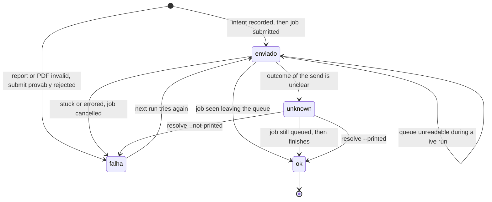

# printguard

[](https://github.com/sergiomeyer23/print-guard/actions/workflows/ci.yml)

Scheduled reports that print, confirm the job left the queue, and alert you when they don't.

## The problem

A scheduled task that prints a report can report success while nothing comes out of the printer. The script exits 0 because it handed the file to the spooler. The spooler then holds the job: the printer is offline, a bad document is blocking the queue, or the machine rebooted halfway through. Nobody finds out until someone asks where the morning report is.

printguard treats "sent" and "printed" as two different states. It builds the PDF, submits it, and keeps reading the queue until the job is gone. If that doesn't happen it cancels the job, writes an alert file and tries again on the next scheduled run. Each attempt is written to a small SQLite journal before the printer is called, and a lock keeps two runs from working at once, so a retry or a reboot does not quietly print the report twice. When the outcome can't be established the day is marked `unknown` and left for a person to settle.

## Demo

```bash
pip install -e ".[dev]"
printguard seed
printguard run
```

`seed` builds a SQLite file of made-up shipments. `run` queries it, renders `out/report_<date>.pdf` with the query time in the header, prints through the simulated printer and marks the day `ok` only after the job is confirmed. Run it again and nothing prints.

To watch a failure, jam the simulated queue:

```bash
printguard seed --force
printguard run --sim-fail stuck --confirm-timeout 4
```

The job is cancelled, the state becomes `falha`, and `out/ALERTA_<date>.txt` gets a line like `job sim-1 not confirmed (last status: queued)`. Run without `--sim-fail` and the next attempt prints once and closes the day.

## Commands

| Command | What it does |
|---|---|
| `printguard seed` | Creates the sample database. Refuses to overwrite without `--force`. |
| `printguard run` | Queries, renders, prints and confirms. Skips the day if it is already `ok`. Recovers an interrupted attempt before doing anything else. |
| `printguard print-only` | Reprints today's existing PDF without touching the data source. Refuses while an attempt is unresolved. |
| `printguard check` | Reports today's state through its exit code. With `--deadline HH:MM` it also writes an alert if the day isn't `ok` by then. |
| `printguard resolve` | Settles an unresolved attempt by hand: `--printed` closes the day, `--not-printed` cancels the job if it can and allows one reprint. |

Exit codes: 0 `ok`, 1 `falha`, 2 pending (not confirmed yet), 3 another instance holds the lock, 4 `unknown`.

Printer options: `--printer simulated` (default) or `--printer spooler --printer-name "Name"`. Add `--event-log` on Windows to also write alerts to the Application event log.

## How a day moves



`unknown` has no timeout. printguard does not read a missing confirmation as a missing page, so it never turns `unknown` into `falha` and reprints by itself. The way out is evidence (the job is still in the queue) or a person running `resolve`.

More detail in [docs/architecture.md](docs/architecture.md).

## Failure modes

| Failure | What printguard does |
|---|---|
| Job stuck in the queue | Waits up to the confirm timeout, cancels the job, state `falha`, alert. If the cancel fails the state is `unknown`. |
| Two runs at the same time | The second exits with code 3 and touches nothing. |
| Process killed before the send | The journal holds an intent with no job. Nothing in the queue proves anything, so the day becomes `unknown`. |
| Process killed right after the send | If the job is still queued, the next run finds it by file name and confirms it. If it already finished, the day becomes `unknown`. |
| Queue unreadable | A live run keeps `enviado` and a later run confirms. A recovery run that can't read the queue records `unknown`. |
| Truncated or empty PDF | Refuses to send it, state `falha`, alert. |
| Run twice in the same day | The second run sees `ok` and exits. |

The full table, including the ones I can't cover, is in [docs/failure-modes.md](docs/failure-modes.md).

## Windows scheduling

`scripts/install_task.ps1 -PrinterName "Your Printer"` registers a scheduled task: 08:00 daily, repeating every 5 minutes until 09:05, plus a trigger 5 minutes after boot, with wake-to-run enabled. `scripts/run_task_entry.ps1` is what the task calls. It exits early if the day is already `ok`, so the repetition costs nothing once the report is out. Run the installer from an elevated PowerShell.

## Limitations

- A job leaving the Windows queue means the spooler finished with it. It does not prove paper came out. A printer that drops a job after accepting it will look like success.
- Recovery trades convenience for safety. A crash before the send, or after a send that printed and left the queue before the next run, both end as `unknown`, and a person decides with `resolve`. In practice that means you will sometimes be asked about a report that printed fine.
- Job matching after a crash relies on the spool job's document name containing the PDF file name. Print handlers that rename documents will fall back to `unknown`.
- `WindowsSpoolerPrinter` prints through the shell `PrintTo` verb, so the machine needs a PDF handler that supports it. It has only been exercised in tests against a fake PowerShell, not on real hardware.
- The PowerShell scripts have not been run on a Windows machine. Read them before trusting them.
- The lock covers one working directory on one machine. Two machines sharing a network folder are not protected from each other.
- One report, one printer, one calendar day per state. This is a small tool, not a scheduler or a framework.

## Development

```bash
pip install -e ".[dev]"
ruff check .
pytest
```

CI runs both on Ubuntu and Windows with the simulated printer. MIT licensed.
