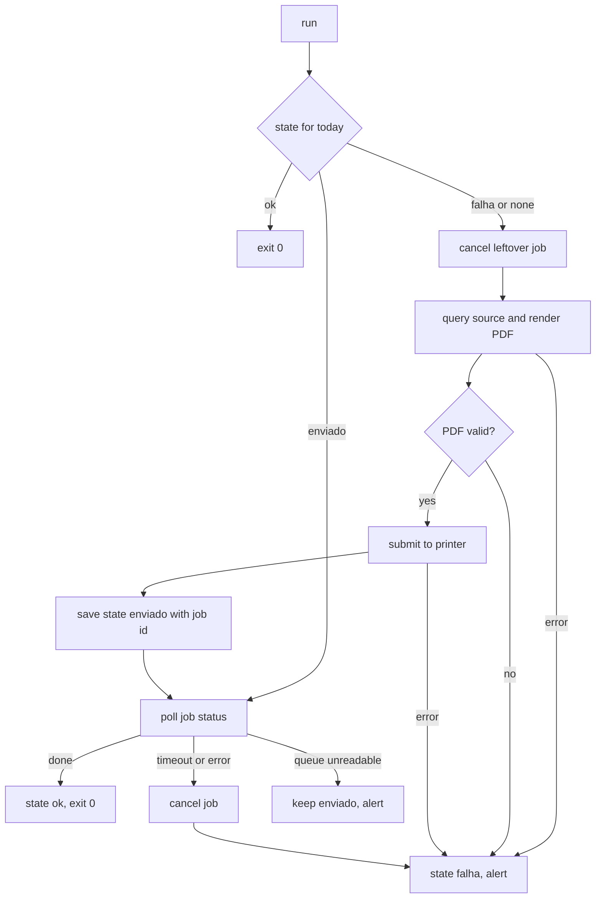

# Architecture

printguard is a small pipeline with one rule: a day only becomes `ok` after the printer confirms the job.

## Flow of `printguard run`

The state is saved as `enviado` before the first poll. That is what lets a rerun after a reboot confirm the job instead of printing it again.

## Modules

| Module | Role |
|---|---|
| `state.py` | Per-day JSON file, written atomically (temp file, fsync, rename). A corrupt file is moved aside to `.corrupt`. |
| `source.py` | Sample SQLite data and the pending-shipments query. |
| `report.py` | A4 PDF with the query time in the header, plus a structural check (header, end marker, size). |
| `printers/` | The `Printer` protocol (`submit`, `status`, `cancel`) and two implementations. |
| `runner.py` | The state machine. Everything external (clock, sleep, source, renderer, printer) is injected, which is how the tests inject faults. |
| `alerts.py` | `ALERTA_<date>.txt` and, optionally, the Windows Event Log. |
| `cli.py` | Argument parsing and wiring. |

## Printer backends

`SimulatedPrinter` keeps its queue in `out/spool/spool.json`, so jobs survive across processes like a real queue would. It can be told to leave jobs stuck or to make the queue unreadable.

`WindowsSpoolerPrinter` lists the queue with `Get-PrintJob` before and after sending the file through the `PrintTo` verb, and takes the new job id from the difference. A job missing from the queue is treated as done. Statuses containing error, offline, paper out or user intervention map to an error.

## Guardian

`scripts/run_task_entry.ps1` runs `check` first and exits if the day is `ok`. Otherwise it runs `run`, and on failure runs `check --deadline` so an alert is written once the window closes. The scheduled task fires every 5 minutes from 08:00 to 09:05 and again 5 minutes after boot, which covers a machine that was off at 08:00.
