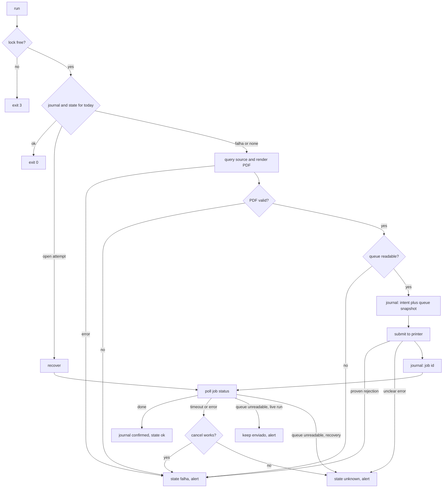

# Architecture

printguard is a small pipeline with two rules. A day only becomes `ok` after the printer confirms the job. Anything that can't be confirmed or refuted stays `unknown` until there is evidence or a person decides.

## Flow of `printguard run`

The intent row is committed before the printer is called. That row, with a snapshot of the job ids already in the queue, is what lets a later run work out what happened.

## Recovery

When a run starts and the journal has an attempt that never closed, it decides from evidence, in this order:

| Journal says | Queue shows | Result |
|---|---|---|
| intent, no job id | exactly one new job whose document name contains the PDF name | adopt it, keep watching, `ok` when it leaves |
| intent, no job id | nothing new | `unknown`: never sent and already printed look the same |
| intent, no job id | several candidates | `unknown` |
| submitted or unknown, with job id | the job, still queued | keep watching; `ok` when it leaves, cancel and `falha` on timeout |
| submitted or unknown, with job id | the job is gone | `unknown`: printed and lost look the same |
| any open attempt | queue can't be read | `unknown` |

Nothing in this table sends a second copy. Reprinting happens only after a person runs `resolve --not-printed`, or after a cancel that the spooler accepted.

## Modules

| Module | Role |
|---|---|
| `state.py` | Per-day JSON summary, written atomically (temp file, fsync, rename). A corrupt file is moved aside to `.corrupt`. |
| `journal.py` | SQLite log of attempts. Each change is its own committed transaction and is the source of truth for recovery. When the JSON summary disagrees with it, the journal wins. |
| `lock.py` | Exclusive lock from the OS (`flock` on Linux, `msvcrt.locking` on Windows). It is released when the process dies, so a crash leaves nothing to clean up. |
| `source.py` | Sample SQLite data and the pending-shipments query. |
| `report.py` | A4 PDF with the query time in the header, plus a structural check (header, end marker, size). |
| `printers/` | The `Printer` protocol (`submit`, `status`, `cancel`, `queue`) and two implementations. |
| `runner.py` | The state machine. Everything external (clock, sleep, source, renderer, printer) is injected, which is how the tests inject faults. |
| `alerts.py` | `ALERTA_<date>.txt` and, optionally, the Windows Event Log. A message identical to the last one is not written again. |
| `cli.py` | Argument parsing and wiring. |

## Printer backends

`SimulatedPrinter` keeps its queue in `out/spool/spool.json`, so jobs survive across processes like a real queue would. It can be told to leave jobs stuck, finish after N polls, or make the queue unreadable.

`WindowsSpoolerPrinter` lists the queue with `Get-PrintJob` before and after sending the file through the `PrintTo` verb, and takes the new job id from the difference. If starting the print fails outright, or the queue can't be read beforehand, nothing was sent and the error is a `SubmitRejected`. A timeout, or a send after which no job shows up, is ambiguous and ends in `unknown`. Statuses containing error, offline, paper out or user intervention map to an error.

## Guardian

`scripts/run_task_entry.ps1` runs `check` first and exits if the day is `ok`. Otherwise it runs `run`, and on failure runs `check --deadline` so an alert is written once the window closes. If `run` reports that another instance holds the lock, the guardian leaves it alone. The scheduled task fires every 5 minutes from 08:00 to 09:05 and again 5 minutes after boot, which covers a machine that was off at 08:00.
